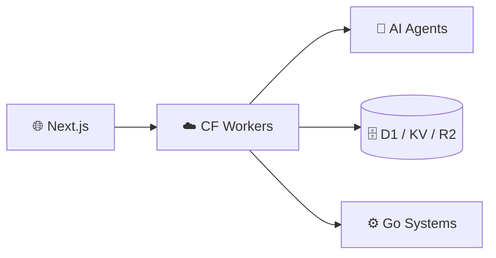

<div align="center">
  
</div>

### ⚡ `whoami`

```yaml
name: "Khoan"
role: "Software & Systems Engineer"
web:  "https://khoan.dev"

current_focus:
  - 🤖 Autonomous AI Agents & Workflows (MCP, Tool Calling, LLM Orchestration)
  - ☁️ Serverless Edge Stack: Cloudflare Workers, D1, KV, R2
  - ⚡ Full-Stack Apps with Next.js & High-Performance Go Backends
  - 🛡️ System Architecture, DevSecOps & Zero-Trust Infrastructure
```

### 🧬 `current_workflow.mermaid`



### 🛠️ `stack`

- **Core:** Go, TypeScript, Next.js, React, TailwindCSS
- **Cloudflare Edge:** Workers, D1 (SQL), KV, R2 (Storage), WAF / Zero-Trust
- **AI & Agents:** AI SDK, LLM Workflows, MCP, Vectorize
- **Systems, Sec & DevOps:** Linux, Docker, CI/CD, Networking, System Hardening

